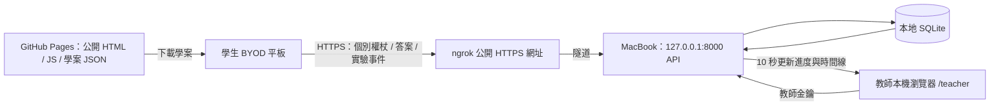

# GitHub Pages ＋ MacBook ＋ ngrok：詳細操作手冊

## A. 架構與網址



前端必須用 **GitHub Pages** 發佈，單純把 HTML 放到 GitHub 倉庫並不等於可瀏覽的網站。GitHub Pages 提供靜態網站，不會執行這個 Python 後端。[GitHub Pages 官方發佈來源說明](https://docs.github.com/en/pages/getting-started-with-github-pages/configuring-a-publishing-source-for-your-github-pages-site)

| 用途 | 例子 | 填在哪裏 |
|---|---|---|
| 學生學案入口 | `https://YOUR_NAME.github.io/s4-inquiry-kit/` | 派給全班 |
| 後端公開入口 | 以 ngrok 顯示的 HTTPS URL 為準 | `docs/config.js` 的 apiBase |
| 教師本機控制台 | `http://127.0.0.1:8001/teacher` | 教師在同一台 MacBook 開啟 |
| 前端來源 Origin | `https://YOUR_NAME.github.io` | `.env` 的 ALLOWED_ORIGINS，沒有倉庫路徑 |

GitHub 網站及 ngrok API 都用 HTTPS，避免混合內容。學生不可使用 `localhost` 作為後端網址：在平板上它指向平板自己。[GitHub HTTPS 說明](https://docs.github.com/en/pages/getting-started-with-github-pages/securing-your-github-pages-site-with-https)

## B. MacBook 首次準備

1. 把專案放在固定資料夾，例如「文件／s4-inquiry-kit」。開啟終端機並 `cd` 到該資料夾。以下命令都在專案根目錄執行。
2. 檢查 `python3 --version`，需要 Python 3.10 或更新版本。如未安裝，從 [Python 官方 macOS 下載](https://www.python.org/downloads/macos/) 安裝。
3. 執行初始化：

```sh
python3 tools/init.py
```

4. 在文字編輯器打開 `.env`。Finder 可用 Command＋Shift＋句號顯示隱藏檔。內有隨機產生的教師金鑰及本機來源設定。不要把內容貼到學生頁、GitHub 或班群。
5. 啟動服務：

```sh
python3 tools/start_server.py
```

6. 安全版的 8000 埠只提供學生 API。先檢查 `http://127.0.0.1:8000/api/health`，再開 `http://127.0.0.1:8001/teacher`，貼上教師金鑰登入。學生頁使用 GitHub Pages；啟動隧道後再驗證學生上傳。
7. 先建立一個測試課堂，代號用 `TEST-01`、`TEST-02`。保存登入碼，學生端加入測試課堂，做三次實驗，教師端應顯示紀錄。

本機可以檢查教師端與 API；GitHub Pages 上的學生頁必須連到有效的 ngrok HTTPS API。安全加固版的最新操作方式，以 06-安全加固與使用.md 為準。

## C. 建立 ngrok HTTPS 隧道

1. 前往 [ngrok 官方開始頁](https://ngrok.com/docs/start) 建立帳戶；依官方方法安裝 macOS ngrok。有 Homebrew 可用：

```sh
brew install ngrok
```

2. 首次在本機設定 ngrok authtoken。把下面佔位字換成 ngrok Dashboard 的值，勿把它加入專案：

```sh
ngrok config add-authtoken YOUR_NGROK_AUTHTOKEN
```

3. 保持 Python 服務運行，另開終端機：

```sh
python3 tools/start_tunnel.py
```

4. 複製 ngrok 顯示的 **HTTPS** 公開網址。依目前官方文件，帳戶會獲派固定 dev domain，重開 agent 一般會沿用；仍以你的 Dashboard 和執行結果為準，不要手動編造域名。[ngrok domains](https://ngrok.com/docs/gateway/domains)
5. 用公開網址加上 `/api/health` 測試，應看到 `ok: true`。若顯示瀏覽器提示頁，可先按 Visit；程式 API 請求已帶 `ngrok-skip-browser-warning: 1`。[免費方案與提示頁說明](https://ngrok.com/docs/pricing-limits/free-plan-limits)

ngrok 是把正在本機運行的服務接到公網，並不會替你永久保存或運行後端。MacBook、Python 程序、ngrok、網路都必須保持運作。學校網路亦可能封鎖 ngrok，必須用學生平板實測。

## D. 設定前後端連接

1. 修改 `docs/config.js`，填入實際 ngrok HTTPS 網址，不加 `/api`，尾端不加 `/`。目前已填入本次 ngrok 網址；更換帳戶或域名時換成 ngrok 顯示的實際網址，並更新學生 HTML 的 connect-src：

```js
window.APP_CONFIG = { apiBase: "https://YOUR_ASSIGNED_NGROK_DOMAIN" };
```

2. 修改 `.env` 的來源白名單。將 YOUR_NAME 換成 GitHub 帳戶或組織名稱：

```text
ALLOWED_ORIGINS=http://127.0.0.1:8000,http://localhost:8000,https://YOUR_NAME.github.io
```

來源格式是協定＋主機＋必要時埠號，**不含** `/s4-inquiry-kit/`，也不加尾端斜線。不要用 `*` 取代。若使用自訂前端網域，把該 HTTPS Origin 一併加入。

3. 停止 Python（Control＋C），重新執行 `python3 tools/start_server.py`，讓新 `.env` 生效。ngrok 可繼續運作。
4. 前端的 API URL 是公開設定，讓學生知道後端在哪裏；安全來自個別學生權杖與教師金鑰。CORS 是瀏覽器跨來源規則，不是身分驗證或阻擋所有外部請求的防火牆。

## E. 把原始碼放上 GitHub，啟用 Pages

目前環境檢查時 GitHub CLI 尚未登入。以下是教師帳戶需要完成的步驟；這份專案包本身不代表已公開部署。

1. 在 GitHub 建立名為 `s4-inquiry-kit` 的倉庫。使用免費 Pages 時通常選 public repo；公開內容只放網站、程式與說明。[GitHub Pages 發佈來源與可用方案](https://docs.github.com/en/pages/getting-started-with-github-pages/configuring-a-publishing-source-for-your-github-pages-site)
2. 安裝 Git 並在本專案根目錄執行。URL 中 YOUR_NAME 必須替換成真實帳戶：

```sh
git init
git branch -M main
git add .gitignore README.md docs backend tools tests guides
git status
git commit -m "Add S4 inquiry classroom prototype"
git remote add origin https://github.com/YOUR_NAME/s4-inquiry-kit.git
git push -u origin main
```

若已初始化或已設 origin，略過相應命令，先用 `git status`、`git remote -v` 核對。推送時依 GitHub 的登入流程認證；若使用 GitHub CLI，先執行 `gh auth login`。不要把 GitHub token 寫進 HTML、remote URL 或說明文件。

3. 在 GitHub 倉庫 **Settings → Pages → Build and deployment → Source** 選 **Deploy from a branch**；分支選 `main`，資料夾選 `/docs`，按 Save。
4. 等待 GitHub 顯示實際網站 URL，並檢查 Pages 的部署結果。可用網址形式通常為 `https://YOUR_NAME.github.io/s4-inquiry-kit/`，但應複製 GitHub 返回的實際 URL。
5. 開啟 Enforce HTTPS（如可選）。平板開啟前端網址，確認載入示範學案，再加入測試課堂。

`.gitignore` 只約束 Git 追蹤，不會保護手動拖到網站的檔案，也不會撤銷已被追蹤的秘密。請只選上面明列的來源目錄。**不得上傳 `.env`、`private/`、SQLite、登入碼清單、班級 JSON/CSV 或學生答案**。GitHub Pages 的公開性與倉庫可見性須依實際方案確認，不用私人 repo 當學生資料庫。

## F. 真實平板端到端驗收

以 2–3 台校內 BYOD 平板先試，使用測試代號，不放真實姓名。

| 步驟 | 應看到的結果 |
|---|---|
| 用平板開 GitHub Pages URL | 網站載入、繁體文字可讀、滑桿可觸控、頁面可捲動 |
| 加入測試課堂 | 顯示正確學生代號及「正式課堂」 |
| 寫預測、計劃、執行三次不同值實驗 | 狀態顯示已同步，表格與動畫數值相符 |
| 教師打開本機控制台 | 約 10 秒內看到實驗數、完成度及時間線 |
| 平板關 Wi-Fi，再填答案、執行一次實驗 | 顯示待傳，資料仍在當前頁保存 |
| 重新開 Wi-Fi | 待傳清空，教師只新增一次該實驗 |
| 提交、教師評分、學生修改推理 | 舊評分標待重評，教師可看到修改紀錄 |
| 教師結束課堂 | 新資料不獲接收；重開後保留待傳佇列可重試 |
| 重啟 Python | 已收到的學生資料仍在 SQLite |

只有這一輪實機測試通過，才算驗證了學校網路、平板瀏覽器、GitHub Pages、ngrok 與 MacBook 的完整鏈路。本地測試不能代替它。

## G. 每節課的操作

**上課前**：啟動後端與 ngrok，避免 MacBook 睡眠；教師端建立新課堂並選擇正確學案；下載個別登入碼並逐一派發；先用測試代號測一筆資料。網頁可沿用，課堂編號與學生登入碼每節重新建立。

如要避免閒置自動睡眠，可用以下命令啟動後端；仍不要合上螢幕或關閉網路：

```sh
caffeinate -i python3 tools/start_server.py
```

**上課中**：查看卡在預測、只亂改變量或沒有公平比較的學生；用口頭追問確認理解；遇到離線先繼續當前已開頁面並匯出備份，不要要求學生清除瀏覽器資料。

**下課前**：學生提交並確認「已同步」；教師確認學生資料到齊後才結束課堂；有待傳的學生應先重開課堂補傳或匯出紀錄。

**下課後**：匯出完整班級 JSON 和評分 CSV；備份 SQLite：

```sh
python3 tools/backup.py
```

備份放在 `private/backups/`。此工具使用 SQLite backup API，適合運行中資料庫；不要在服務仍運行時只複製主 `.sqlite` 而漏掉 WAL。另存到學校核准的受保護儲存位置，驗證檔案可開啟。還原前停後端、保留當前資料、以備份替換資料庫並確保沒有舊的 `-wal`／`-shm` 混用；正式使用前先以副本演練還原。

學生備份 JSON 不包含登入權杖，供人工補證。沒有自動將任意備份灌回正式資料庫的介面，以免把可自行修改的檔案當作已驗證紀錄。教師可閱讀備份及口頭確認後，在評語補充離線情況。

## H. 常見問題

| 現象 | 處理 |
|---|---|
| GitHub URL 回 404 | 確認 Pages 選 main／docs，網站入口為倉庫路徑而非 raw GitHub 檔案 URL |
| 畫面一直示範、不能正式登入 | 設好 config.js 的 apiBase，推送後重新整理；未登入操作不會上傳 |
| CORS 錯誤 | `.env` 放 GitHub Origin，沒有 repo 路徑；重啟後端 |
| API 回 HTML 或 ngrok 提示頁 | 確認 apiBase 是後端根 URL；本程式已加 ngrok bypass header；檢查服務與 ngrok 是否在線 |
| 待傳佇列不清空 | 保留頁面，檢查網路、登入 12 小時有效期、課堂是否結束；必要時同一登入碼重登入；先匯出備份 |
| 課堂已結束 | 教師重新開啟該課堂，平板按重新連線或等待重試 |
| 登入碼遺失 | 建立時即下載；本原型只保存碼的雜湊，沒有明碼找回功能。可另建補交課堂並人工對照 |
| 想使用另一個埠 | 同時改 PORT、ALLOWED_ORIGINS、ngrok 轉發埠；本機非 8000 時明確設定 config.js 的 apiBase |
| MacBook 重開後學生仍看得到網頁卻傳不到資料 | GitHub 前端仍在線，重新啟動後端與 ngrok；未接收的資料仍在原平板待傳 |

本程式約 0.7 秒答案保存、10 秒教師輪詢與重試，會產生請求。ngrok 免費方案有每月流量、請求與速率限制；先試課並查看 Dashboard 用量，再決定是否升級。不要把任何方案的「免費」當成可無限支援全校。具體數值以 [ngrok 現行限制](https://ngrok.com/docs/pricing-limits/free-plan-limits) 為準。
