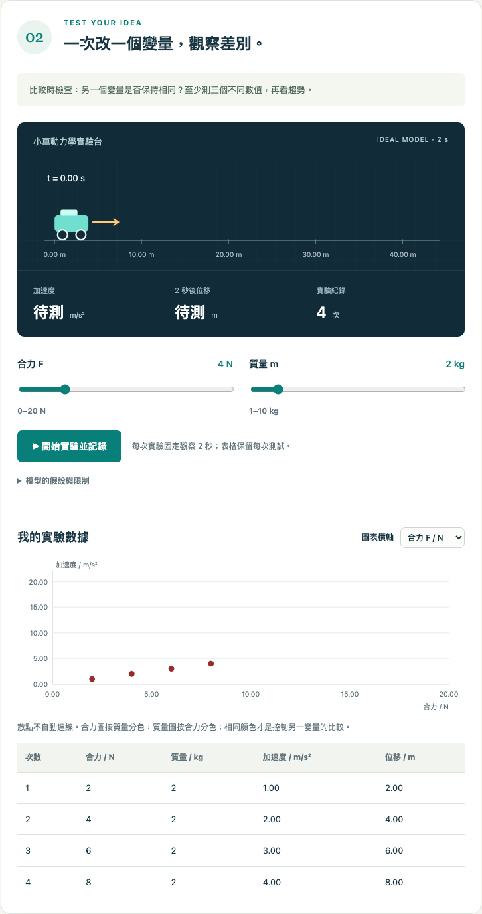
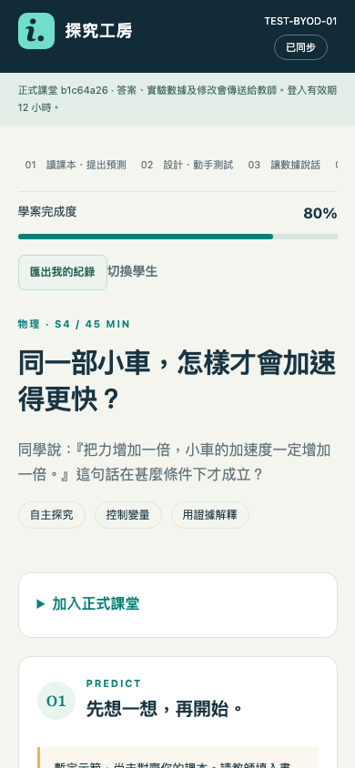
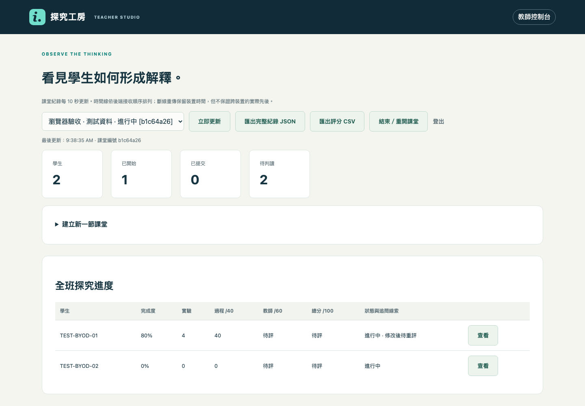

# 檢驗報告

檢驗日期：2026 年 11 月 18 日（澳門時間）。所有驗證均使用合成學生代號與測試答案，沒有使用真實學生資料。

## 已驗證

### 後端與資料模型

`python3 -m unittest discover -s tests -v`：9 項測試通過。

| 測試 | 實際檢查內容 | 結果 |
|---|---|---|
| 模型與單位 | 10 N／2 kg → 5 m/s²、2 秒位移 10 m；未知模型拒絕 | 通過 |
| 操作不等同思考 | 亂拖滑桿與實驗後才補預測／計劃，不獲事前過程分 | 通過 |
| 權限與檔案隔離 | 無金鑰／學生權杖不能讀教師資料；不能經 HTTP 讀 .env、資料庫或後端程式 | 通過 |
| 來源白名單 | 未允許來源的 POST 被拒絕 | 通過 |
| 原子驗證 | 含不合法事件的一批資料全部回滾；越界值與錯步長拒收 | 通過 |
| 伺服器重算 | 客戶端偽報加速度不被採用，後端依 F/m 重算 | 通過 |
| 重傳與學生隔離 | 同一事件連傳三次只記一次；A 無法讀 B 的資料；相同 ID 不同內容拒收 | 通過 |
| 工作流程與評分 | 完整學案完成度 100%；過程 40 分、教師 46 分 → 86 分；修訂後待重評；舊版本評分拒收；結束與重開課堂 | 通過 |
| 同時上傳及持久化 | 10 個執行緒同時提交合共 30 筆事件不遺失；重啟程序後數據仍在 | 通過 |

表格按功能拆開說明；其中部分功能屬同一個測試案例，實際 unittest 案例總數是 9，不是表格列數的累加。

發現並修復：學生資料新增時的 SQL 參數數量錯誤；每請求資料庫連線未明確釋放；尚有未保存文字時切換研究變量會被畫面更新重設的問題。修復後重新執行測試通過。

JavaScript 的學生程式、教師程式已通過 Node.js 語法檢查；Python 程式已通過編譯檢查。

### 瀏覽器與教學互動

以 Playwright Chromium 在本機建立獨立瀏覽器環境，使用 1024×900 觸控視窗及 390×844 窄視窗。測試使用真實 HTML、JS、HTTP API 與 SQLite，沒有以假資料 API 取代後端。

- 教師登入、建立兩位測試學生的課堂、產生個別登入碼：通過。
- 學生加入正式課堂，研究變量在 force／mass 之間切換：通過。
- 2、4、6 N，質量 2 kg 的三次實驗；最後 a=3 m/s²、位移 6 m：通過。
- 暫時斷網、填答案及加做 8 N 實驗，恢復後共四次實驗且沒有重複：通過。
- 完整填寫、提交、教師查看答案和實驗時間線、保存四項評分：通過。
- 重新載入後恢復學生身份、答案和四次實驗：通過。
- 學生修改推理，教師端顯示「修改後待重評」：通過。
- 窄視窗沒有整頁水平溢出；完成流程期間沒有未捕捉 JavaScript 錯誤：通過。
- 零合力時加速度和位移為零、力箭頭隱藏；輸入後立即重新整理保留文字：通過。

瀏覽器檢查腳本為 `tests/browser.test.cjs`，開發環境需要 Playwright 和 Chromium。一般上課運行不需要安裝 Node.js 或 Playwright。該腳本會在本地資料庫建立合成測試課堂，應於測試環境執行。

### 實際 ngrok HTTPS 傳輸

使用這台 MacBook 已配置的 ngrok 帳戶啟動 HTTP 8000 隧道。把返回的公開 HTTPS URL 寫入 `docs/config.js`，再完整重跑同一套瀏覽器工作流程。

結果：本機前端 Origin → ngrok 公開 HTTPS API → MacBook SQLite 的登入、答案／實驗事件、斷網補傳、提交全部通過；教師本機控制台讀到相同四次實驗。另以瀏覽器跨來源 fetch 檢查公開 `/api/health`，返回 HTTP 200 及 ok=true。

這驗證了真實的 HTTPS 隧道與瀏覽器 CORS，**尚不是已部署 GitHub Pages 後的校內平板驗收**。

### 備份

運行中執行 `tools/backup.py`，得到 SQLite 一致性備份；以另一個 SQLite 連線讀取備份並執行 `PRAGMA integrity_check`，結果為 `ok`，事件數與當時來源資料庫一致（48 筆合成測試事件）。

## 尚未驗證或未實現

- GitHub CLI 檢查顯示尚未登入；未建立 GitHub 倉庫、未啟用 Pages，也沒有聲稱已上線。
- 尚未收到科目、課題、課本版本與頁碼，示範教材仍是暫定物理內容。
- 未使用真實校內 BYOD 平板或 iPad Safari 測試；Chromium 觸控尺寸檢查不等於 Safari／校內網路驗收。
- 未做全班同時登入的實機壓力測試；30 筆並行事件不是 60 台裝置的容量承諾。
- 尚未校準分數與學生實際理解程度的關係；自動過程分不可單獨用於判斷思考、誠信或高風險學業決策。
- 只支援 newton 仿真模型；沒有自動解析整本課本、直接呼叫 AI 大量生成或 AI 自動評閱功能。
- 沒有離線首次開啟／可靠離線重載、跨裝置衝突解決、多教師帳號、校務 SSO 或備份自動匯入介面。

## 交付狀態

程式原型、三份操作／教學手冊、生成提示詞、測試、畫面預覽已完成。壓縮包排除 `.env`、資料庫、學生／班級匯出、登入碼與快取；本地測試產生的秘密及資料只留在被忽略的私有目錄。

驗證結束後停止本次啟動的 Python 與 ngrok 程序，避免把測試連結當作常駐正式服務。重新啟動步驟見 README 及部署手冊。

